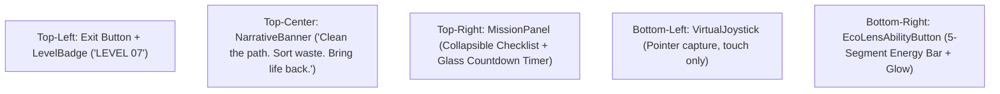

# Green Meadows Rescue (Level 7) — Architectural & Implementation Plan

> [!NOTE]
> This document specifies the architecture, scene layout, HUD mechanics, and implementation phases for Level 7: "Green Meadows Rescue" in EcoSort Heroes.

---

## 1. Overview & Vision

**Level 7: Green Meadows Rescue** introduces a split-world ecological narrative. The player (Kai) arrives at Green Meadows Residency, a gated residential complex whose central paver pathway divides a dry, polluted dirt yard on the left from a lush green lawn on the right.

### Core Objectives
1. **Explore the Complex**: Navigate via touch joystick or keyboard/click-to-move along the central paver walkway.
2. **Clear the Pathway**: Clean littered waste along the walk to restore the residential gardens.
3. **Multi-Bin Sorting**: Segregate biodegradable wet waste, dry recyclables, hazardous items, and residual waste into their respective designated bins.
4. **Garden Restoration**: Transform the depleted left half into a thriving green garden upon mission completion.

---

## 2. Spatial & Scene Architecture

```
Z = -12.5  ──────────────  Building Rear
Z =  -8.5  ──────────────  Building Entrance & Canopy (Obstacle)
Z =  -7.5  ──────────────  Paver Walkway Starts
Z =  +3.0  ──────────────  Midpoint & Litter Scatter
Z = +10.0  ──────────────  Player Spawn Point (Faces Building)
Z = +14.0  ──────────────  Scene Rear Boundary
```

### Key Elements
- **Ground Plane**: Split vertex-colored terrain (Dirt: `#6b4a32`, Grass: `#5fae3a`).
- **Central Walkway**: Paver stones (`width = 3.5m`, `halfWidth = 1.75m`) with concrete curbs (`#b9a284`).
- **Residency Building**: 12m peach facade (`#d9a98b`), terracotta roof (`#b5654a`), entrance portico, and sign sprite: `"GREEN MEADOWS RESIDENCY"`.
- **Lighting & Atmosphere**: Warm morning sunlight (`#ffd9a0`), hemisphere ambient light, peach exponential fog (`#f3ddc0`, density `0.012`), and 2 decorative street lamps.

---

## 3. HUD & Control System

Level 7 utilizes an immersive dark-glass HUD (`.hud-glass`) overlay:



### Control Dynamics
- **Virtual Joystick**: 
  - Base: 128px, Knob: 52px, Max Travel: 38px.
  - Dead zone: `JOYSTICK_DEAD_ZONE = 0.15`.
  - Camera-relative translation: stick up moves forward along camera azimuth; stick down moves backward without rotating character.
- **Eco Lens Ability**:
  - 5-segment energy bar.
  - In Level 7, activates for 3 seconds to scan waste and reveal bin alignments, then initiates cooldown.

---

## 4. Phase Status & Implementation Checklist

### ✅ Phase 1: Configuration & Routing
- `src/types/game.ts`: Added `'MEADOWS'` to `SceneType` union.
- `src/data/levels.ts`: Added Level 7 "Green Meadows Rescue" (`sceneType: 'MEADOWS'`, 90s timer, 12 target items).
- `WorldCanvas.tsx`: Dynamic environment resolution (`resolveEnvMode`), engine handles `MEADOWS` lifecycle, hides classic town bins.
- `WorldPage.tsx`: Wired `isMeadowsMode`, mobile joystick refs, timer autostart, and Meadows lens activation.

### ✅ Phase 2: Scene Scaffolding
- `src/components/world/meadowsScene.ts`: Split vertex-colored ground, paver path with curbs, 12m residency building, collision obstacles, warm hemisphere/directional lighting, animated street lamps.

### ✅ Phase 3: Meadows HUD & Controls
- `locomotion.ts`: `setJoystickVector()`, dead zone thresholding, `joystickToMoveDir()` calculation.
- `src/components/game/meadows/`:
  - `LevelBadge.tsx`
  - `NarrativeBanner.tsx`
  - `MissionPanel.tsx` (collapsible drawer + task list)
  - `VirtualJoystick.tsx` (pointer capture & gesture isolation)
  - `EcoLensAbilityButton.tsx` (5 segments)
  - `MeadowHud.tsx` (composition layout)
- `CountdownTimer.tsx`: Added `variant="glass"` support.

### 🟡 Phase 4: Environmental Props (Next)
- [ ] Dumpster unit at the left dirty yard.
- [ ] Scattered trash piles and litter hotspots along the paver curbs.
- [ ] Low-poly procedural trees (acacia / banyan style) and garden bench on the right grass lawn.
- [ ] Flower beds along the walkway perimeter.

### 🟡 Phase 5: Restoration Mechanic & Mission Checklist (Next)
- [ ] Track cleanup progress for the 3 mission tasks:
  1. `clean`: Clear litter in proximity to the building entrance.
  2. `sort`: Sort collected items into bins with high accuracy.
  3. `garden`: Bring energy above threshold to trigger lawn bloom.
- [ ] Transition dirty yard terrain material / vertex colors toward lush green upon completion.

### 🟡 Phase 6: Visual Effects & Post-Processing (Next)
- [ ] Subtle bloom on street lamp glass and illuminated windows.
- [ ] Celebration particle bursts when completing garden restoration.
