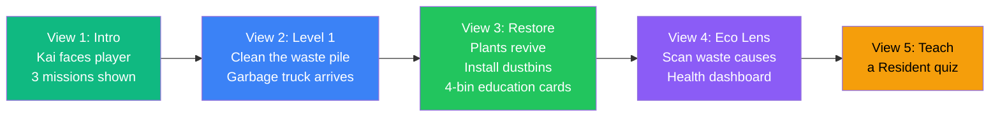
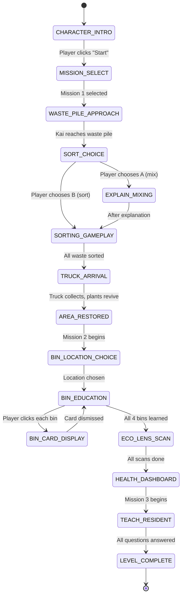
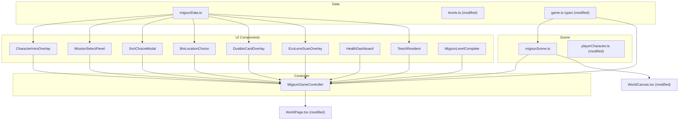

# 🏘️ Migsun Vilasa — New World Implementation Plan

> [!IMPORTANT]
> This plan creates a **complete new world** for EcoSort Heroes set in **Migsun Vilasa**, an Indian residential society. It follows Anshu's vision: narrative-driven, multi-view gameplay with character introduction, waste pile cleanup, garbage truck arrival with "Gadi Wala Aaya" song, dustbin education cards, Eco Lens scanning, a neighbourhood health dashboard, and a teach-a-resident quiz system.

---

## 0. Vision Summary



### Three Missions
1. **Clean the Waste** — Pick up litter, sort it, call the garbage truck.
2. **Install Dustbins** — Choose the right location, learn about each bin.
3. **Teach About Cleaning** — Answer resident questions, prove you learned.

---

## 1. What Already Exists (Reusable)

| Asset / System | File | Reuse? |
|---|---|---|
| Society Scene (3D layout, bins, building, truck) | [societyScene.ts](file:///Users/bombermac/hackathon/EcoSort/src/components/world/societyScene.ts) | ✅ Fork as `migsunScene.ts` |
| Litter Scatter System | [litterScatter.ts](file:///Users/bombermac/hackathon/EcoSort/src/components/world/litterScatter.ts) | ✅ Reuse directly |
| Player Character (Kai) | [playerCharacter.ts](file:///Users/bombermac/hackathon/EcoSort/src/components/world/playerCharacter.ts) | ✅ Add front-facing idle pose |
| Locomotion (WASD, click-to-move) | [locomotion.ts](file:///Users/bombermac/hackathon/EcoSort/src/components/world/locomotion.ts) | ✅ As-is |
| 3rd-person Camera | [thirdPersonCamera.ts](file:///Users/bombermac/hackathon/EcoSort/src/components/world/thirdPersonCamera.ts) | ✅ As-is |
| Countdown Timer | [CountdownTimer.tsx](file:///Users/bombermac/hackathon/EcoSort/src/components/game/CountdownTimer.tsx) | ✅ As-is |
| Eco Lens System | [ecoLens.ts](file:///Users/bombermac/hackathon/EcoSort/src/systems/ecoLens.ts) | ✅ Extend for cause-effect scans |
| Mascot Dialogue | [MascotDialogue.tsx](file:///Users/bombermac/hackathon/EcoSort/src/components/game/MascotDialogue.tsx) | ✅ As-is |
| Audio Service (Polly + Web Audio) | [audio.ts](file:///Users/bombermac/hackathon/EcoSort/src/services/audio.ts) | ✅ Add new sounds |
| 15+ 3D item meshes | [items/models/](file:///Users/bombermac/hackathon/EcoSort/src/components/world/items/models/) | ✅ All reusable |
| 7-bin system | [bins.ts](file:///Users/bombermac/hackathon/EcoSort/src/data/bins.ts) | ✅ 4 bins for this level |
| WorldCanvas rendering | [WorldCanvas.tsx](file:///Users/bombermac/hackathon/EcoSort/src/components/world/WorldCanvas.tsx) | ✅ Add `MIGSUN` env mode |
| WorldPage game logic | [WorldPage.tsx](file:///Users/bombermac/hackathon/EcoSort/src/components/world/WorldPage.tsx) | ✅ Extend with new phases |
| App routing | [App.tsx](file:///Users/bombermac/hackathon/EcoSort/src/App.tsx) | ✅ No change needed |

---

## 2. Architecture: Game Phase State Machine

The Migsun Vilasa world is a **multi-phase narrative level**, not a single timer-based sort. Each phase transitions automatically based on player actions.



---

## 3. Implementation Phases (Step-by-Step)

### Phase 1 — Level Config & Scene Foundation (Day 1)

#### 1.1 Add Migsun Vilasa Level to `levels.ts`

**File:** [src/data/levels.ts](file:///Users/bombermac/hackathon/EcoSort/src/data/levels.ts)

```typescript
{
  id: 8,
  name: 'Migsun Vilasa',
  place: 'Migsun Vilasa Society',
  bins: ['wet', 'dry', 'hazardous', 'residual'],
  learningGoal: 'Clean the waste, install bins, and teach residents.',
  energyLink: 'A clean society means healthy plants, happy people.',
  targetCount: 15,
  sceneType: 'MIGSUN',   // NEW env mode
  timeLimit: 120,         // longer — multi-phase level
}
```

#### 1.2 Add `MIGSUN` Scene Type

**File:** [src/types/game.ts](file:///Users/bombermac/hackathon/EcoSort/src/types/game.ts)

Add `'MIGSUN'` to the `SceneType` union (alongside `'SOCIETY'` and `'MEADOWS'`).

#### 1.3 Create Migsun Scene — `migsunScene.ts`

**New file:** `src/components/world/migsunScene.ts`

Fork from [societyScene.ts](file:///Users/bombermac/hackathon/EcoSort/src/components/world/societyScene.ts) (898 lines). Key differences:

```
┌──────────────────────────────────────────────────────────┐
│                    ROAD (top, Z = -14)                   │
│  ═══════════════════════════════════════════             │
│              🚛 Truck path (arrives from right) →        │
├──────────────────────────────────────────────────────────┤
│                                                          │
│   🏢🏢🏢 Migsun Vilasa Apartments                       │
│   (3-story, balconies, "MIGSUN VILASA" text on gate)    │
│                                                          │
│   ╔════════════╗    ╔══════════════╗                     │
│   ║ WASTE PILE ║    ║  CLEAN SIDE  ║                     │
│   ║ 🍌📦🔋💊  ║    ║  🌿🌸🌳🦋  ║                     │
│   ║ Flies, pest║    ║  Flowers,    ║                     │
│   ║ particles  ║    ║  birds       ║                     │
│   ╚════════════╝    ╚══════════════╝                     │
│                                                          │
│   [ BIN INSTALL SPOTS ]                                  │
│   A: Main entrance    B: Near garden    C: Walkway       │
│                                                          │
│   🧍 Kai (facing camera, Z = +6)                        │
│                                                          │
│   "MIGSUN VILASA" entrance gate (Z = +8)                │
└──────────────────────────────────────────────────────────┘
```

**Scene elements (procedural Three.js):**

| Element | Geometry | Details |
|---|---|---|
| Migsun Vilasa building | BoxGeometry stack | 3-story, warm cream walls, blue balconies, "MIGSUN VILASA" CanvasTexture |
| Entrance gate | BoxGeometry + arch | Iron gate mesh with society name |
| Waste pile (left half) | Compound group | Scattered 3D waste meshes, brown ground, fly particles |
| Clean garden (right half) | ConeGeometry trees + colored planes | Green ground, flowers, butterfly particles |
| 3 bin install locations | Ground markers (dashed outlines) | A: entrance, B: garden-adjacent, C: walkway (blocking) |
| 4 dustbins (hidden initially) | CylinderGeometry | Green, Blue, Red, Black — appear after bin-install phase |
| Road strip | PlaneGeometry | Asphalt at Z = -14 |
| Garbage truck | Compound BoxGeometry | White-green municipal truck |
| Street lamps | CylinderGeometry + SphereGeometry | Warm point lights |
| Bench | BoxGeometry | Near garden, hides 1–2 litter items |
| Pest particles | THREE.Points | Small dots swarming near waste pile |
| Plant revival meshes | ConeGeometry (initially gray) | Turn green after cleanup |

**Export interface:**

```typescript
export interface MigsunSceneResult {
  sceneGroup: THREE.Group;
  obstacles: WorldObstacle[];
  
  // Waste pile
  wastePileGroup: THREE.Group;          // toggled visible/hidden after cleanup
  cleanGardenGroup: THREE.Group;        // starts dim, brightens after cleanup
  revivalPlants: THREE.Mesh[];          // gray → green transition
  pestParticles: THREE.Points;          // removed after cleanup
  
  // Bins (appear in phase 2)
  binMeshes: Map<BinType, THREE.Mesh>;
  binTriggers: Map<BinType, THREE.Mesh>;
  binGlowRings: Map<BinType, THREE.Mesh>;
  binInstallLocations: { id: string; label: string; position: THREE.Vector3; isCorrect: boolean }[];
  
  // Litter
  litterSpawnPoints: THREE.Vector3[];
  hiddenSpawnPoints: THREE.Vector3[];
  
  // Truck
  truckMesh: THREE.Group;
  truckStartPos: THREE.Vector3;
  truckEndPos: THREE.Vector3;
  
  // Animation
  animate: (elapsed: number, delta: number) => void;
  triggerBinAnimation: (bin: BinType) => void;
  animateTruckArrival: (progress: number) => void;
  triggerPlantRevival: () => void;        // NEW — gray → green transition
  showBinsAtLocation: (locationId: string) => void; // NEW — install bins
  removePests: () => void;                // NEW — remove fly particles
}
```

---

### Phase 2 — Character Introduction & Dialogue System (Day 2)

#### 2.1 Character Intro Overlay — `CharacterIntroOverlay.tsx`

**New file:** `src/components/game/migsun/CharacterIntroOverlay.tsx`

A fullscreen overlay that plays before gameplay. Kai faces the camera (front-facing idle pose).

**Sequence (auto-advancing with voice + text):**

| Step | Dialogue | Voice | Visual |
|---|---|---|---|
| 1 | "Welcome to Migsun Vilasa!" | Polly or speechSynthesis | Kai waves, camera zooms to face |
| 2 | "Look around. One side is buried in unmanaged waste, while the other is full of life." | Voice | Camera pans left (waste) then right (garden) |
| 3 | "The garbage pile is attracting pests. Litter is spreading towards the plants. Our shared space is becoming unhealthy." | Voice | Pest particles intensify, waste pile highlighted |
| 4 | "Your mission is to clean the area, sort the waste correctly, and help restore the neighbourhood. Every action counts!" | Voice | Mission list appears with icons |
| 5 | **LEVEL 1: The Waste Pile Problem** | Title card | Bold text with animation |
| 6 | **Objective: Clean. Sort. Restore.** | Subtitle | Below title |
| 7 | **Hint: Use your Eco Lens to discover how waste affects nature.** | Smaller text | Eco Lens icon pulses |

**After intro → Show Mission Select panel.**

#### 2.2 Mission Select Panel — `MissionSelectPanel.tsx`

**New file:** `src/components/game/migsun/MissionSelectPanel.tsx`

Three mission cards displayed over the 3D scene:

```
┌─────────────────────────────────────────────────────┐
│           YOUR MISSIONS                              │
│                                                      │
│  ┌──────────┐  ┌──────────┐  ┌──────────┐          │
│  │ 🧹       │  │ 🗑️       │  │ 📚       │          │
│  │ Clean    │  │ Install  │  │ Teach    │          │
│  │ the      │  │ Dustbins │  │ About    │          │
│  │ Waste    │  │          │  │ Cleaning │          │
│  │          │  │ 🔒       │  │ 🔒       │          │
│  │ [START]  │  │ locked   │  │ locked   │          │
│  └──────────┘  └──────────┘  └──────────┘          │
│                                                      │
└─────────────────────────────────────────────────────┘
```

- Mission 1 is unlocked. Missions 2 and 3 unlock sequentially.
- Clicking "START" on Mission 1 → Kai runs toward the waste pile.

#### 2.3 Kai Front-Facing Pose

**Modify:** [playerCharacter.ts](file:///Users/bombermac/hackathon/EcoSort/src/components/world/playerCharacter.ts)

Add a `setFacingCamera(camera: THREE.Camera)` method that rotates the character to face the camera. Used during intro sequence.

---

### Phase 3 — Mission 1: Clean the Waste (Day 3)

#### 3.1 Sort Choice Modal — `SortChoiceModal.tsx`

**New file:** `src/components/game/migsun/SortChoiceModal.tsx`

Before the garbage truck arrives, display two choices:

```
┌─────────────────────────────────────────────────┐
│        How will you handle the waste?            │
│                                                   │
│  ┌──────────────────┐  ┌──────────────────┐      │
│  │ A: Throw          │  │ B: Sort waste    │      │
│  │ everything into   │  │ into the correct │      │
│  │ one bin.          │  │ categories.      │      │
│  │                   │  │                  │      │
│  │  [Choose A]       │  │  [Choose B] ✅   │      │
│  └──────────────────┘  └──────────────────┘      │
│                                                   │
└─────────────────────────────────────────────────┘
```

**Behavior:**

- **Choice A** → Modal explains: "Mixing waste can make recycling and organic-waste processing more difficult. Sorted waste helps create compost and recover recyclable materials." Then auto-switches to Choice B flow.
- **Choice B** → Player earns +20 bonus points. Timer starts. Sorting gameplay begins.

#### 3.2 Sorting Gameplay (Reuse Existing System)

Reuse the existing litter scatter + pickup + throw-to-bin system from [WorldPage.tsx](file:///Users/bombermac/hackathon/EcoSort/src/components/world/WorldPage.tsx) and [WorldCanvas.tsx](file:///Users/bombermac/hackathon/EcoSort/src/components/world/WorldCanvas.tsx). The Society mode already handles:

- Walk to item → pick up → walk to bin → throw
- Wrong bin → item returns to hand + explanation
- Eco Lens hint on 2nd wrong attempt
- Score, streak, energy tracking

#### 3.3 Garbage Truck Arrival with "Gadi Wala Aaya" Song

**Modify:** [audio.ts](file:///Users/bombermac/hackathon/EcoSort/src/services/audio.ts)

Add `playGadiWalaAaya()` method:

```typescript
/** Play the "Gadi Wala Aaya, Ghar Se Kachra Nikalo" jingle.
 *  Uses Web Audio API oscillators to play a simplified, recognizable melody.
 *  Falls back to a cheerful horn sequence if the melody is too complex. */
playGadiWalaAaya(): void {
  // Melody notes approximation (C major, kid-friendly tempo)
  // Ga-di wa-la aa-ya, ghar se kach-ra ni-ka-lo
  const melody = [
    { freq: 523, dur: 0.3 },  // C5 - Ga
    { freq: 587, dur: 0.3 },  // D5 - di
    { freq: 659, dur: 0.3 },  // E5 - wa
    { freq: 587, dur: 0.3 },  // D5 - la
    { freq: 523, dur: 0.6 },  // C5 - aa-ya
    // ... (full melody implementation)
  ];
  // Play via oscillator chain
}
```

**Alternative:** Load a short `.mp3` jingle from S3/public assets for authenticity.

**Truck animation sequence:**
1. All waste sorted → mascot says "Great job! The truck is coming!"
2. Truck horn sounds
3. "Gadi Wala Aaya" jingle plays
4. Truck drives in from right side of scene along road
5. Truck stops at bin area
6. Bins flash → waste "collected" (fade out)
7. Score tally for Mission 1 shown briefly

---

### Phase 4 — Area Restoration & Dustbin Installation (Day 4)

#### 4.1 Plant Revival Animation

**In `migsunScene.ts`:**

After truck collects waste:

1. Waste pile group fades out (opacity → 0 over 2 seconds)
2. Pest particles removed (`removePests()`)
3. Revival plants transition: gray material → green material over 3 seconds
4. New flower meshes spawn near the cleared area
5. Butterfly particles appear
6. Ground texture under waste pile changes from brown/dirty to green

```typescript
triggerPlantRevival(): void {
  // Lerp each plant mesh material color from gray to green
  // Spawn flower meshes at pre-defined positions
  // Start butterfly particle system
  // Transition ground plane texture
}
```

**Mascot dialogue:** "Look! The plants are coming back to life! Clean spaces help nature grow."

#### 4.2 Bin Location Choice — `BinLocationChoice.tsx`

**New file:** `src/components/game/migsun/BinLocationChoice.tsx`

Three location options displayed over the 3D scene with camera panning to each:

```
┌─────────────────────────────────────────────────────┐
│    Where should we install the bins?                 │
│                                                      │
│  ┌──────────────┐  ┌──────────────┐  ┌────────────┐ │
│  │ A: Beside     │  │ B: Near the  │  │ C: On the  │ │
│  │ the main      │  │ garden       │  │ walkway    │ │
│  │ entrance      │  │              │  │            │ │
│  │               │  │              │  │            │ │
│  │ [Choose]      │  │ [Choose]     │  │ [Choose]   │ │
│  └──────────────┘  └──────────────┘  └────────────┘ │
│                                                      │
│  Hint: Pick a spot that is easy to reach and does    │
│  not block people or sit beside sensitive plants.    │
└─────────────────────────────────────────────────────┘
```

**Behavior:**

| Choice | Result | Explanation |
|---|---|---|
| A: Main entrance | ✅ Best | "Good choice! Residents can use the bins on the way in and out. Waste collectors can reach them easily." |
| B: Near garden | ⚠️ Acceptable | "This works, but bins near plants can attract pests. The entrance is a better spot." |
| C: Walkway | ❌ Wrong | "Bins on the walkway block people. Children and elderly residents cannot pass safely. Try again." |

- Choice A or B → bins appear at that location in the 3D scene, +10 or +5 points
- Choice C → explanation shown, player must choose again

#### 4.3 Dustbin Education Cards — `DustbinCardOverlay.tsx`

**New file:** `src/components/game/migsun/DustbinCardOverlay.tsx`

After bins are installed, the 4 dustbins appear in the scene. When the player clicks each bin, a card appears beside the bin:

```
  ┌─────────────────────────────────────┐
  │  🟢 GREEN BIN — Wet & Food Waste    │
  │                                      │
  │  🔊 [Play Voice]                     │
  │                                      │
  │  "Food scraps, fruit peels, and     │
  │   leaves go here. They become       │
  │   compost and biogas."              │
  │                                      │
  │  Examples:                           │
  │  🍌 Banana peel  🍎 Apple core      │
  │  🥬 Veggie scraps  🍞 Bread         │
  │                                      │
  │  ❓ Quick Question:                  │
  │  "Where does a tea bag go?"          │
  │  [Green ✅]  [Blue]  [Red]  [Black] │
  │                                      │
  └─────────────────────────────────────┘
```

**Card data structure:**

```typescript
interface DustbinCard {
  binType: BinType;
  title: string;
  description: string;        // voice message text
  examples: { icon: string; name: string }[];
  practiceQuestion: {
    question: string;
    options: { label: string; binType: BinType }[];
    correctBin: BinType;
    explanation: string;
  };
}
```

**Cards for the 4 bins:**

| Bin | Voice message | Examples | Practice Q |
|---|---|---|---|
| 🟢 Green | "Food scraps and leaves go here. They become compost and biogas for cooking." | Banana peel, apple core, veggie scraps, tea bag | "Where does a used paper plate with food go?" → Green |
| 🔵 Blue | "Clean paper, plastic bottles, and metal cans go here. They become new products." | Newspaper, plastic bottle, soda can, milk carton | "Where does a clean cereal box go?" → Blue |
| 🔴 Red | "Old batteries and medicine go here. They have dangerous chemicals." | Battery, light bulb, expired medicine | "Where does an old phone charger go?" → Red (or E-waste) |
| ⚫ Black | "Items that cannot be recycled or composted go here." | Used tissue, broken pen, soiled wrapper | "Where does a used bandage go?" → Black |

**Voice playback:** Use `audio.speak(description)` or load Polly-generated audio from S3.

**Interaction flow:**
1. Player clicks bin in 3D scene → card slides in from the side
2. Voice auto-plays (with play button for replay)
3. Player answers practice question
4. Correct → green checkmark + "Well done!" → card dismisses, bin gets a ✅ badge
5. Wrong → explanation shown, correct answer highlighted
6. Repeat for all 4 bins
7. After all 4 learned → transition to Eco Lens phase

---

### Phase 5 — Eco Lens Cause-Effect Scanning (Day 5)

#### 5.1 Extend Eco Lens for Environmental Scans

**Modify:** [ecoLens.ts](file:///Users/bombermac/hackathon/EcoSort/src/systems/ecoLens.ts)

Add a new scan mode for environmental cause-effect discovery:

```typescript
interface EcoScanTarget {
  id: string;
  name: string;
  position: THREE.Vector3;   // where it exists in scene
  scanResult: {
    cause: string;
    effect: string;
    icon: string;
    voiceText: string;
  };
}
```

**4 scan targets in Migsun Vilasa scene:**

| Target | Cause | Effect |
|---|---|---|
| 🍌 Food-waste pile | "When food waste sits in the open, it rots and creates methane gas." | "Methane heats the atmosphere. Covered composting prevents this." |
| 🦟 Standing water container | "Containers collect rainwater. Standing water breeds mosquitoes." | "Mosquitoes spread diseases like dengue. Remove or cover open containers." |
| 🌱 Damaged plant area | "Litter blocks sunlight and releases chemicals into the soil." | "Plants cannot grow. Roots absorb toxins. Cleaning the area restores growth." |
| 🚰 Littered drain | "Waste blocks the drain. Water cannot flow during rain." | "Blocked drains cause flooding and water-borne diseases. Keep drains clear." |

#### 5.2 Eco Lens Scan UI — `EcoLensScanOverlay.tsx`

**New file:** `src/components/game/migsun/EcoLensScanOverlay.tsx`

When scanning:
1. Screen gets teal/cyan tint
2. Scan targets glow with pulsing outlines
3. Player clicks a target → scan animation (circular sweep)
4. Card appears with cause → effect explanation
5. Voice reads the explanation
6. Scanned target gets a ✅ badge
7. After all 4 scanned → "All causes discovered!" → dashboard appears

---

### Phase 6 — Neighbourhood Health Dashboard (Day 5–6)

#### 6.1 Health Dashboard Component — `HealthDashboard.tsx`

**New file:** `src/components/game/migsun/HealthDashboard.tsx`

A HUD panel showing three game indicator scores:

```
┌─────────────────────────────────────────────────────┐
│          🏘️ NEIGHBOURHOOD HEALTH                     │
│                                                      │
│  🧹 Cleanliness     ████████░░  78%                 │
│  🗑️ Correct Sorting  ██████████  92%                │
│  🛡️ Prevention       ██████░░░░  55%                │
│                                                      │
│  ℹ️ These are game scores, not real measurements.    │
│                                                      │
│  Overall: ⭐⭐⭐ ECO CHAMPION                       │
└─────────────────────────────────────────────────────┘
```

**Score formulas:**

| Metric | Formula | Source |
|---|---|---|
| Cleanliness | `(itemsPickedUp / totalLitter) × 100` | Litter scatter system |
| Correct Sorting | `(correctFirstTry / totalSorted) × 100` | Throw tracking |
| Prevention | `(ecoLensScansComplete / totalScanTargets + binQuizzesCorrect / totalBinQuizzes) × 50` | Eco Lens + bin cards |

> [!NOTE]
> The dashboard explicitly states "These are game scores, not real measurements" per Anshu's requirement.

---

### Phase 7 — Mission 3: Teach a Resident (Day 6)

#### 7.1 Teach-a-Resident System — `TeachResident.tsx`

**New file:** `src/components/game/migsun/TeachResident.tsx`

A virtual resident NPC appears and asks questions. The player must answer correctly to prove learning.

**NPC visual:** Simple 3D character (BoxGeometry person) with a speech bubble.

**Questions (5 total, randomized from pool):**

| Resident asks | Correct answer | Explanation |
|---|---|---|
| "Where should I put this banana peel?" | 🟢 Green bin | "Banana peels decompose. They make compost in the green bin." |
| "I have an old battery. Which bin?" | 🔴 Red bin | "Batteries have acid and heavy metals. Always use the red bin." |
| "This newspaper is clean. Where does it go?" | 🔵 Blue bin | "Clean paper is recyclable. Put it in the blue bin." |
| "My pen is broken. Can I recycle it?" | ⚫ Black bin | "Mixed-material items that cannot be separated go in the black bin." |
| "There is water collecting in this old can. What should I do?" | "Empty and flatten the can" | "Standing water breeds mosquitoes. Empty containers before disposal." |
| "Where does a used tissue go?" | ⚫ Black bin | "Used tissues cannot be composted or recycled. Black bin." |
| "My child's milk carton is empty. Which bin?" | 🔵 Blue bin | "Rinse it first, then put it in the blue bin for recycling." |
| "Should I throw food waste in a plastic bag?" | "No, put it directly in the green bin" | "Plastic bags contaminate compost. Use a paper liner or put food directly in the bin." |

**UI:**

```
┌─────────────────────────────────────────────────┐
│  🧑 Resident:                                   │
│  "Where should I put this banana peel?"          │
│                                                   │
│  🧒 Kai (you) — Choose your answer:             │
│                                                   │
│  ┌──────────┐ ┌──────────┐                       │
│  │ 🟢 Green │ │ 🔵 Blue  │                       │
│  └──────────┘ └──────────┘                       │
│  ┌──────────┐ ┌──────────┐                       │
│  │ 🔴 Red   │ │ ⚫ Black │                       │
│  └──────────┘ └──────────┘                       │
│                                                   │
│  Progress: ✅ ✅ ❓ ❓ ❓  (2/5)                  │
│                                                   │
└─────────────────────────────────────────────────┘
```

**Behavior:**
- Correct → "Well done! You taught the resident." +15 points
- Wrong → "Not quite. [Explanation]." Resident asks again. No point deduction.
- After 5 correct → "Mission Complete! You are a true Eco Hero!"

---

### Phase 8 — Level Complete & Polish (Day 7)

#### 8.1 Level Complete Screen — `MigsunLevelComplete.tsx`

**New file:** `src/components/game/migsun/MigsunLevelComplete.tsx`

```
┌─────────────────────────────────────────────────┐
│         🏆 MIGSUN VILASA — RESTORED!             │
│                                                   │
│  Mission 1: Clean the Waste     ⭐⭐⭐            │
│  Mission 2: Install Dustbins    ⭐⭐⭐            │
│  Mission 3: Teach Residents     ⭐⭐              │
│                                                   │
│  ─── Your Impact ───                             │
│  🧹 Items sorted: 15/15                          │
│  🗑️ Sorting accuracy: 87%                        │
│  🔍 Eco Lens scans: 4/4                          │
│  📚 Residents taught: 5/5                        │
│  🌱 Plants revived: 6                            │
│                                                   │
│  Neighbourhood Health: ⭐⭐⭐ ECO CHAMPION        │
│                                                   │
│  [🔄 Play Again]  [🏠 Home]  [➡️ Next Level]    │
└─────────────────────────────────────────────────┘
```

#### 8.2 Sound Effects to Add

**Modify:** [audio.ts](file:///Users/bombermac/hackathon/EcoSort/src/services/audio.ts)

| Method | Sound | When |
|---|---|---|
| `playGadiWalaAaya()` | Hindi truck jingle melody | Truck arrives |
| `playPlantRevival()` | Gentle chime + birds chirping | Plants turn green |
| `playBinInstall()` | Metal clank + success tone | Bins placed |
| `playResidentQuestion()` | Doorbell / attention tone | Resident asks |
| `playResidentCorrect()` | Happy ding + clap | Correct teaching |
| `playEcoScan()` | Sci-fi sweep + data beep | Eco Lens environmental scan |
| `playDashboardReveal()` | Orchestral swell | Dashboard appears |

#### 8.3 Camera Choreography

During the intro and transitions between phases, the camera should move cinematically:

| Phase transition | Camera movement |
|---|---|
| Intro → waste pile | Pan from Kai → slow orbit showing waste vs. garden contrast |
| Sort choice | Close-up on waste pile |
| Sorting gameplay | Standard 3rd-person follow |
| Truck arrival | Fixed wide shot showing truck driving in |
| Plant revival | Slow zoom on clearing area, then pan to revived plants |
| Bin installation | Overhead view of the 3 location options |
| Bin education | Close-up on each bin when clicked |
| Eco Lens scan | Free-look with scan targets highlighted |
| Teach resident | Medium shot of Kai + resident NPC |

---

## 4. File Change Summary

### New Files (12)

| File | Purpose | Complexity |
|---|---|---|
| `src/components/world/migsunScene.ts` | 3D Migsun Vilasa scene | 🔴 High (fork of societyScene.ts) |
| `src/components/game/migsun/CharacterIntroOverlay.tsx` | Intro dialogue sequence | 🟡 Medium |
| `src/components/game/migsun/MissionSelectPanel.tsx` | 3 mission cards | 🟢 Low |
| `src/components/game/migsun/SortChoiceModal.tsx` | A vs B sort decision | 🟢 Low |
| `src/components/game/migsun/BinLocationChoice.tsx` | 3 location options | 🟡 Medium |
| `src/components/game/migsun/DustbinCardOverlay.tsx` | 4 bin education cards | 🟡 Medium |
| `src/components/game/migsun/EcoLensScanOverlay.tsx` | Environmental scan UI | 🟡 Medium |
| `src/components/game/migsun/HealthDashboard.tsx` | 3-metric health display | 🟢 Low |
| `src/components/game/migsun/TeachResident.tsx` | Quiz with virtual resident | 🟡 Medium |
| `src/components/game/migsun/MigsunLevelComplete.tsx` | Results screen | 🟢 Low |
| `src/components/game/migsun/MigsunGameController.tsx` | Phase state machine | 🔴 High |
| `src/data/migsunData.ts` | All content data for this world | 🟢 Low |

### Modified Files (6)

| File | Changes |
|---|---|
| [src/types/game.ts](file:///Users/bombermac/hackathon/EcoSort/src/types/game.ts) | Add `'MIGSUN'` to SceneType, add `MigsunPhase` type |
| [src/data/levels.ts](file:///Users/bombermac/hackathon/EcoSort/src/data/levels.ts) | Add Level 8 config |
| [src/components/world/WorldCanvas.tsx](file:///Users/bombermac/hackathon/EcoSort/src/components/world/WorldCanvas.tsx) | Add `MIGSUN` env mode branch |
| [src/components/world/WorldPage.tsx](file:///Users/bombermac/hackathon/EcoSort/src/components/world/WorldPage.tsx) | Add Migsun phase management, render `MigsunGameController` |
| [src/services/audio.ts](file:///Users/bombermac/hackathon/EcoSort/src/services/audio.ts) | 7 new sound methods |
| [src/components/world/playerCharacter.ts](file:///Users/bombermac/hackathon/EcoSort/src/components/world/playerCharacter.ts) | `setFacingCamera()` method |

---

## 5. Implementation Order & Milestones

```mermaid
flowchart LR
    A["M1: Scene +\nIntro Dialogue"] --> B["M2: Sort Choice +\nSorting Gameplay"]
    B --> C["M3: Truck Arrival\n+ Gadi Wala Aaya"]
    C --> D["M4: Plant Revival +\nBin Installation"]
    D --> E["M5: Bin Education\nCards + Voice"]
    E --> F["M6: Eco Lens\nScans"]
    F --> G["M7: Health Dashboard\n+ Teach Resident"]
    G --> H["M8: Polish:\nSounds, Camera,\nLevel Complete"]

    style A fill:#10b981,color:#fff
    style B fill:#10b981,color:#fff
    style C fill:#3b82f6,color:#fff
    style D fill:#3b82f6,color:#fff
    style E fill:#8b5cf6,color:#fff
    style F fill:#8b5cf6,color:#fff
    style G fill:#f59e0b,color:#000
    style H fill:#f59e0b,color:#000
```



### Milestone Checkpoints

| Milestone | What to demo | Validates |
|---|---|---|
| **M1** | Kai faces camera, intro dialogue plays with voice, camera pans waste vs. garden | Intro narrative works |
| **M2** | Player chooses A or B, sorts waste, wrong-bin feedback works | Core gameplay loop |
| **M3** | Truck drives in with "Gadi Wala Aaya" jingle, waste collected | Truck + audio |
| **M4** | Plants turn green, pests removed, player chooses bin location | Restoration + choice mechanic |
| **M5** | Click each bin → card with voice + practice question | Education system |
| **M6** | Eco Lens scans 4 environmental targets with cause-effect cards | Environmental learning |
| **M7** | Health dashboard shows 3 scores, resident asks 5 questions | Dashboard + quiz |
| **M8** | Full playthrough with sounds, camera movements, level complete screen | Complete experience |

> [!IMPORTANT]
> **M3 is the "wow" moment** — the garbage truck arriving with the iconic Hindi song while waste gets collected is the most memorable, shareable feature. Prioritize this for the demo.

---

## 6. Data File: `migsunData.ts`

**New file:** `src/data/migsunData.ts`

Contains all content data for the Migsun Vilasa world:

```typescript
export const MIGSUN_INTRO_DIALOGUE = [
  { text: "Welcome to Migsun Vilasa!", emotion: "happy" },
  { text: "Look around. One side is buried in unmanaged waste, while the other is full of life.", emotion: "concerned" },
  { text: "The garbage pile is attracting pests, litter is spreading towards the plants, and our shared space is becoming unhealthy.", emotion: "serious" },
  { text: "Your mission is to clean the area, sort the waste correctly, and help restore the neighbourhood. Every action counts!", emotion: "determined" },
];

export const MIGSUN_LEVEL_TITLE = "LEVEL 1: The Waste Pile Problem";
export const MIGSUN_OBJECTIVE = "Objective: Clean. Sort. Restore.";
export const MIGSUN_HINT = "Hint: Use your Eco Lens to discover how waste affects nature.";

export const BIN_LOCATIONS = [ /* ... */ ];
export const DUSTBIN_CARDS = [ /* ... */ ];
export const ECO_SCAN_TARGETS = [ /* ... */ ];
export const RESIDENT_QUESTIONS = [ /* ... */ ];
```

---

## 7. Technical Notes

### Performance
- Migsun scene targets ~250 draw calls max (procedural geometry)
- Pest particles use `THREE.Points` with BufferGeometry (single draw call)
- Plant revival uses material color lerp, not mesh swap
- Bin cards are React overlays, not 3D (cheaper rendering)

### Accessibility
- All bins: **color + icon + text label + distinct shape**
- Voice plays for every dialogue and explanation
- Practice questions have text alternatives
- Timer pauses in portrait mode (existing behavior)
- All text follows ASD-STE100: ≤ 8 words per game sentence

### Mobile / Touch
- Intro: tap to advance dialogue
- Sort choice: tap A or B
- Bin location: tap option
- Bin cards: tap bin in 3D → card appears
- Teach resident: tap answer option
- All existing touch controls (pick up, sort) work unchanged

---

## 8. Dependency Graph



---

> [!TIP]
> **Quick-start order:** Build the scene (`migsunScene.ts`), then the controller (`MigsunGameController.tsx`), then each UI component in phase order. Test each phase independently before wiring them together.
